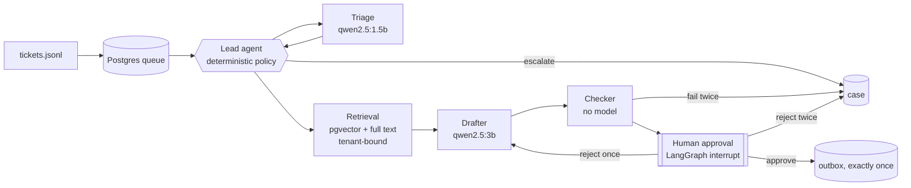

# Project Relay

A small multi-agent support desk for two tenants (Northwind Cycles, Harbor Dental).
It triages every ticket, retrieves from that tenant's knowledge base only, drafts a
grounded reply when it is safe to, checks the draft with deterministic rules, and
**stops for a human before anything reaches a customer**. Everything runs on local
models through Ollama, with PostgreSQL + pgvector for data, vectors, queue, workflow
checkpoints and the live event log. Orchestration is LangGraph.



Details: [TECHNICAL_GUIDE](docs/TECHNICAL_GUIDE.md) (everything in one place: stack, model
parameters, agents, methodology, every file) · [ARCHITECTURE](docs/ARCHITECTURE.md) · [DECISIONS](docs/DECISIONS.md) ·
[EVAL](docs/EVAL.md) · [RUNBOOK](docs/RUNBOOK.md) · [LIMITATIONS](docs/LIMITATIONS.md) ·
[AI_USAGE](docs/AI_USAGE.md)

## Quickstart from a clean clone

Prerequisites (all free): Docker (Desktop or Engine), [uv](https://docs.astral.sh/uv/),
[Ollama](https://ollama.com/download), Node 18+ (only for the web console).

```bash
ollama pull qwen2.5:1.5b
ollama pull qwen2.5:3b
ollama pull nomic-embed-text

git clone <this repo> relay && cd relay
make demo
```

`make demo` checks dependencies (with actionable errors if Docker, Ollama or a model
is missing), starts Postgres + pgvector, applies migrations (schema, RLS, app role,
checkpoint tables), embeds both KBs, processes both inboxes and prints the approval
queue and the escalation cases. No `.env` is needed; defaults are in `.env.example`.

Then:

```bash
make approve                                   # list pending drafts with checker results
make approve ID=apr-5876b41c9454 BY=yourname   # approve -> out/outbox.jsonl (exactly once)
make reject  ID=apr-… REASON='why' BY=yourname # one redraft, then escalation
make run INBOX=path/to/other_tickets.jsonl     # any file in the same format
make eval RUNS=5                               # golden-set evaluation -> docs/EVAL.md
make test                                      # 118 tests, Postgres only (no Ollama)
make dev                                       # API :8077 + console http://localhost:5173
```

All commands, including walkthrough demonstrations, are listed in [`run.txt`](run.txt).
The underlying CLI is `uv run relay --help` (`migrate`, `seed`, `run`, `worker`,
`approvals list|show|approve|reject`, `cases`, `eval`, `report`, `health`, `export`).

## Outputs
* `out/decisions.jsonl` – one row per ticket, exactly the Appendix B schema; regenerated
  from the database, so re-runs never duplicate.
* `out/outbox.jsonl` – approved messages only, at most one per ticket.
* `out/rejected.jsonl` – tickets refused at intake (unknown tenant, malformed line).
* `eval/runs/run_N.jsonl`, `eval/runs/summary.json` – evaluation records.

## Web console
`make dev`, then open http://localhost:5173. Pages: Operations dashboard, Live agent
monitor (the compiled LangGraph, lit by real execution events over SSE), Run inspector
(Developer mode ON shows node timeline, typed contracts, routing overrides, token
counts, retrieval scores, checker rules, queue lease), Tickets, Approvals, Escalations,
Evaluation lab, System health. All numbers come from the API and database. Developer
mode is presentation only; it does not change what the backend authorizes.

## Requirement status

| ID | Requirement | Status | Evidence |
|---|---|---|---|
| C1 | One command from a clean clone | Done | `make demo`; timed below |
| C2 | Lead + 3 sub-agents, typed contracts, one repair then classified failure | Done | `relay/contracts.py`, `relay/graph.py`; `test_invalid_output_*` |
| C3 | pgvector retrieval over the current tenant only | Done | `relay/agents/retrieval.py` (RLS + explicit predicate); isolation tests |
| C4 | Deterministic checker (all listed rules + grounding rules) | Done | `relay/agents/checker.py`; `tests/test_checker.py` |
| C5 | Approval CLI, exactly-once outbox, one redraft, full audit | Done | `relay/approvals.py`; approval tests; `audit_log` |
| C6 | RLS, non-superuser role, FORCE, fails closed, tested | Done | migrations `0001` (tenant tables) and `0002` (LangGraph checkpoint tables); `tests/test_isolation.py`, `tests/test_checkpoint_isolation.py` |
| C7 | decisions.jsonl contract, any inbox, idempotent re-runs | Done | `relay/outputs.py`; schema + re-run tests |
| E1 | Gateway: routing, per-call metering, ticket/run budgets → held_budget | Done | `relay/gateway.py`; budget tests |
| E2 | Postgres queue, leases, idempotency, backoff+jitter, dead letter, kill-safe | Done | `relay/queue.py`; lease tests; real `kill -9` run (RUNBOOK) |
| E3 | `make eval RUNS=5` with all required metrics | Done | `docs/EVAL.md` |
| E4 | Pytest without Ollama (fake model) | Done | 118 tests, ~4 s |
| S1 | Circuit breaker + fallback, `CHAOS_FAIL_RATE` | Partial | chaos injection + retries only; no breaker/fallback |
| S2 | Internal and client report views | Done | `make report`, `make report VIEW=client TENANT=…`; web console |
| S3 | CI | Done (not yet run on GitHub) | `.github/workflows/ci.yml` |
| S4 | Scaling note | Done | `docs/DECISIONS.md` §10 |

## Measured results (from this machine)

* **Hardware:** Apple M5, 16 GB RAM, macOS (Darwin 25.5). Docker Desktop 29.7, Ollama 0.24.
* **`make demo` from a fresh `git clone`** (no `.venv`, no outputs, empty database volume):
  **90 s** wall time, of which 78 s processing the 24 tickets. The Docker image, uv
  package cache and Ollama models were already on this machine; a new machine adds the
  `pgvector/pgvector:pg17` image pull and dependency downloads.
* **Committed outputs** (`out/`) come from a fresh `make demo` run by the candidate,
  who read the drafts and made the approval decisions: HD-T09 approved from the CLI
  (`drishti`), NW-T01 approved in the web console (recorded under the console's local
  login, `operator`).
* **Evaluation** (5 runs × 24 tickets, drafting on): action accuracy 79.2%, category 87.5%,
  injection recall 100% with 0% false positives, stability 100%, about 10 minutes for
  5 runs (611 s); identical results in three separate evaluation sessions. See [EVAL](docs/EVAL.md).
* **Tests:** 118 passed (`make test`).

## Assumptions
* **The lead agent is deterministic code.** The brief's lead "plans, routes, enforces
  budgets, writes the decision"; none of that needs a model, and safety rules must not
  depend on one.
* **Escalations draft nothing** (`draft_reply: null`) and carry `kb_refs: []`.
* **`model` lists every model used for the ticket**, including the embedding model,
  joined with `+`; `tokens_in/out` sum every call (embedding calls report input tokens only).
* **Decision status stays at its decision-time value.** Approval and sending are tracked
  in `approvals`/`outbox`, because Appendix B allows only four statuses. A second
  rejection changes the decision to `escalated`.
* **Re-running** skips decided tickets, re-processes `held_budget`/`failed` ones, and
  resumes jobs left unfinished by a killed run.
* **Unknown-tenant tickets** are not written to decisions.jsonl (they have no valid
  tenant); they go to `out/rejected.jsonl` and the `rejections` table.
* **Tenant display names** (for leak detection) and the "clinical questions are never
  answered" flag live in `config/tenants.json`.
* **The API port is 8077** (8000 was taken on the development machine); override with
  `RELAY_API_PORT`.

## Time spent

* Start: 28 October 2026, 14:00 IST
* End: 28 October 2026, 16:00 IST
* Total time spent: about 2 hours of build and verification (model downloads and
  Docker/Ollama setup were done before the start, as the brief allows)
* How: the code was generated with Claude Code from the candidate's build prompts (see
  [AI_USAGE](docs/AI_USAGE.md)). The Git history was created after implementation and
  is grouped by component, not by the order the work happened; commit dates are the
  real dates the commits were made.

## License
MIT, see [LICENSE](LICENSE).
