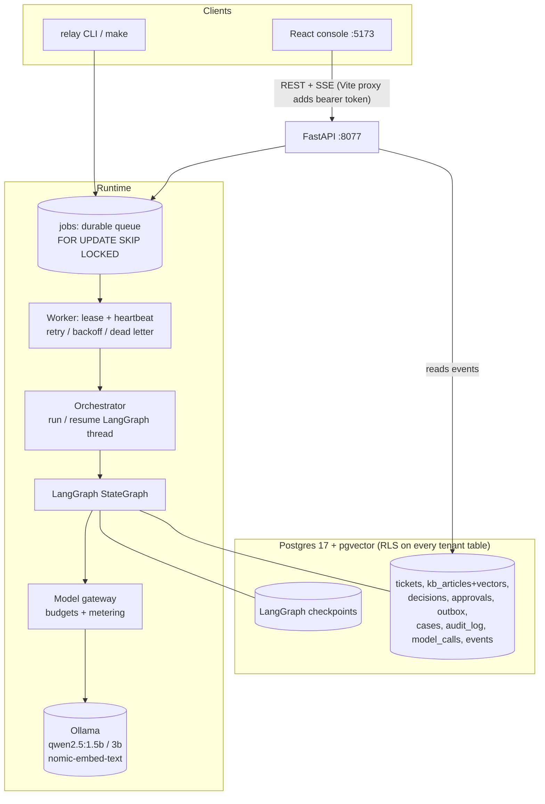
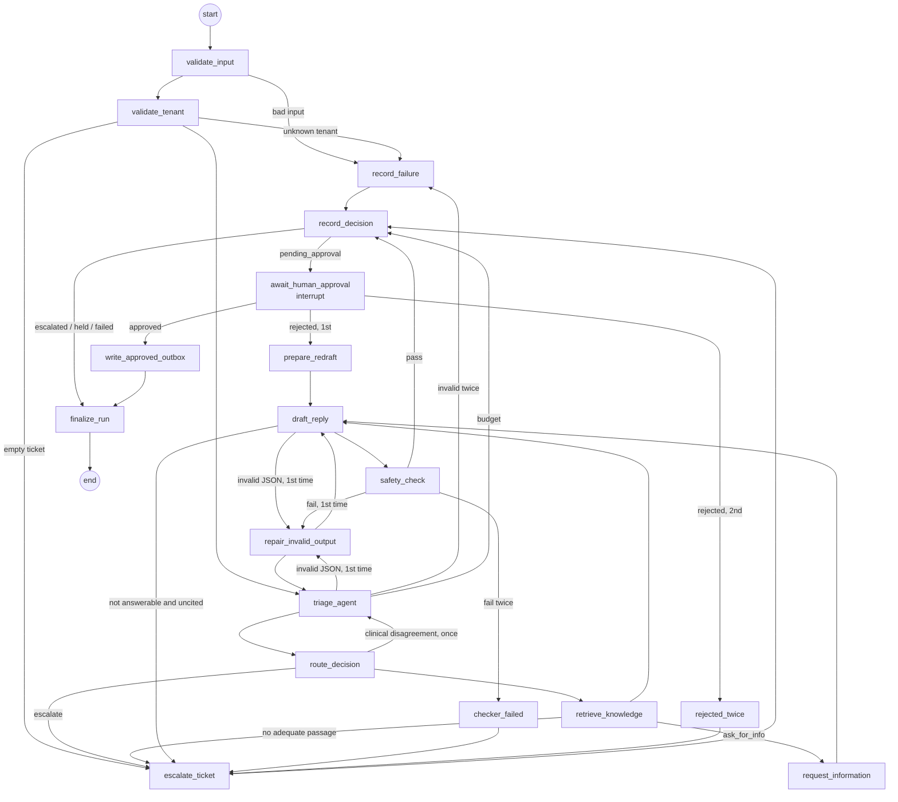

# Architecture

## Overview

Everything runs locally: Ollama for inference, one Postgres container for data,
vectors, queue, checkpoints and the event log. There is no broker and no paid API.

## Why LangGraph

The brief's hard parts are orchestration properties: typed handoffs, bounded loops,
a pause for a human that survives a restart, and resumption after a crash. LangGraph
gives those directly: a typed `StateGraph`, conditional edges, `interrupt()` +
`Command(resume=...)`, and a Postgres checkpointer that persists state after every
step (`durability="sync"`). Plain Python would need a hand-rolled state machine and
persistence layer to do the same. The trade-off is a framework dependency whose
checkpoint tables are not tenant-aware (see Isolation, below).

## Lead agent vs specialists

The **lead agent is deterministic code**, not an LLM. It never pretends otherwise.
It owns planning, routing, budgets and the final decision record. Specialists do
the work that needs a model or retrieval.

| Role | Node(s) | Sees | Returns (contract) |
|---|---|---|---|
| Lead (orchestration) | `validate_input`, `validate_tenant`, `route_decision`, `request_information`, `repair_invalid_output`, `escalate_ticket`, `record_decision`, `await_human_approval`, `prepare_redraft`, `write_approved_outbox`, `record_failure`, `finalize_run`, `checker_failed`, `rejected_twice` | ticket, sub-agent outputs, budget state | `RouteDecision`, `DecisionRow` |
| Triage agent (qwen2.5:1.5b) | `triage_agent` | ticket text only, never the KB | `TriageResult` |
| Retrieval (deterministic) | `retrieve_knowledge` | ticket text + a tenant-bound DB session | `RetrievalResult` (`Passage[]` = kb_id, text, score) |
| Drafter (qwen2.5:3b) | `draft_reply` | ticket + customer-safe passages (never internal articles) | `DraftResult` |
| Checker (deterministic) | `safety_check` | draft, passages, tenant KB index | `CheckResult` (rule id, pass/fail, safe message) |
| Human approver | `await_human_approval` (interrupt) | approval queue (CLI/UI) | `ApprovalDecision` |

Contracts live in `relay/contracts.py`. Model output is constrained by Ollama's
JSON-schema `format` and parsed by Pydantic (`model_validate_json`), never by regex.

**How the lead decides** (`relay/agents/lead.py`): triage *proposes* an action;
deterministic signals (`relay/agents/signals.py`) can only make the outcome safer:

* injection detected → escalate, priority at least high
* clinical language at a clinical-restricted tenant (Harbor) → escalate as `clinical`;
  severe symptoms → urgent
* legal threat → escalate, urgent; money dispute → escalate, at least high
* someone else's records without consent → ask_for_info (consent)
* consistency: ask_for_info with nothing actually missing → draft_reply
* model says "clinical" but the detector finds no clinical language → the lead asks
  triage once more with that observation; a repeated "clinical" escalates

Every override is recorded on the `RouteDecision` and shown in Developer mode.

## The graph (state machine for one ticket)

Bounds: one schema repair per model stage, one checker-driven redraft, one clinical
re-check, one human-rejection redraft. Every path ends at `END` or at a durable
interrupt. The Live Monitor draws this from `GET /api/graph`, which serializes the
compiled graph; only screen positions are hand-placed.

### State

`RelayState` (`relay/graph.py`) is a Pydantic model: ids (`thread_id`, `run_id`,
`tenant_id`, `ticket_id`), the ticket, each specialist's typed output (`triage`,
`signals`, `route`, `retrieval`, `draft`, `check`), counters for the bounded loops,
`usage` (one record per model call), the approval decision, and the final status.
It holds no credentials and no internal KB text: retrieval returns internal
articles as ids only. Types allowed in checkpoints are allowlisted
(`orchestrator.CHECKPOINT_TYPES`); anything else is refused on load.

### Checkpointing, interrupt and resume

* One LangGraph thread per ticket generation: `tenant:ticket:gN`.
* `PostgresSaver` stores a checkpoint after every node (`durability="sync"`), on a
  connection bound to the thread's tenant (see Checkpoint isolation below).
* `await_human_approval` first creates the approval row (idempotent on
  `(thread_id, attempt)`), emits `approval_required`, then calls `interrupt()`.
  The process may exit; the pause lives in Postgres.
* `relay approvals approve` (or the API) locks the approval row, marks it decided and
  audits it in one transaction, then calls
  `graph.invoke(Command(resume=...))` on the same thread. The node re-runs from its
  top (LangGraph semantics), finds its approval row already exists, and returns the
  decision. If the process dies between the commit and the resume,
  `approvals.reconcile()` (run by `relay worker` at start) resumes it.
* A crash mid-graph: the next worker sees `snapshot.next` without an interrupt and
  calls `graph.invoke(None)`, continuing from the last checkpoint (a test proves the
  triage call is not repeated).

## Durable queue

`jobs` rows hold references only (tenant, ticket id, generation); ticket text lives
in RLS-protected `tickets`. Claiming uses
`UPDATE … WHERE job_id = (SELECT … FOR UPDATE SKIP LOCKED LIMIT 1)`. A heartbeat
thread extends the 30 s lease while a job runs; a dead worker's lease expires and the
job is reclaimed. Failures are classified: transient (`ModelUnavailable`,
`ModelTimeout`, DB `OperationalError`) retry with full-jitter exponential backoff up
to `RELAY_MAX_ATTEMPTS`; permanent (`ModelMissing`) or exhausted jobs dead-letter
into a `cases` row (owner `ops-oncall`, `sev2`, reason) plus a `failed` decision.

Idempotency: `jobs.idempotency_key` (unique), one `decisions` row per
`(tenant, ticket)`, approvals unique per `(thread, attempt)`, outbox unique per
ticket **and** per `idempotency_key`. Re-running an inbox skips decided tickets,
adopts unfinished jobs from a killed run, and re-processes only `held_budget` /
`failed` tickets (as a new generation). This is effectively-once business
outcomes, not exactly-once execution: a model call may run twice after a crash.

## Model gateway

`relay/gateway.py` is the only code that talks to a model. It routes by task
(triage → 1.5B, draft → 3B, embed → nomic-embed-text), checks budgets **before**
each call (per ticket: tokens already spent + prompt estimate; per run: the `runs`
counter), records every call in `model_calls` with Ollama's `prompt_eval_count` /
`eval_count` (NULL if not reported, never estimated), classifies errors, and can
inject failures (`CHAOS_FAIL_RATE`). A budget stop becomes `held_budget`, never a crash.

## Isolation

* **RLS** on all ten tenant tables and the three LangGraph checkpoint tables: `ENABLE` + `FORCE ROW LEVEL SECURITY`, one policy
  `USING/WITH CHECK (tenant_id = current_setting('app.tenant_id', true))`. Unset or
  empty context matches nothing: zero rows, and writes are rejected (fail closed).
* The app connects as `relay_app`: `NOSUPERUSER NOBYPASSRLS`, no DDL, and
  `audit_log`, `outbox`, `model_calls`, `events` are append-only (no UPDATE/DELETE).
* `tenant_tx(tenant)` validates the tenant against the registry and sets
  `app.tenant_id` with `set_config(..., true)` (transaction-local), so a pooled
  connection never carries a tenant into the next transaction.
* Unknown tenants are rejected at intake and logged to `rejections`; no default tenant exists.
* Retrieval runs inside the tenant transaction and also filters on the setting.
* The checker blocks other tenants' names and KB ids, internal ids/text, canaries.
* The API maps a bearer token to an operator and a tenant grant; every query runs
  inside `tenant_tx` for a granted tenant. SSE streams are built from per-tenant RLS
  queries, so events never cross tenants.
* Exports (`out/*.jsonl`) are scanned for internal ids, internal text and canaries
  before writing; a hit aborts the export.

### Checkpoint isolation

LangGraph's checkpoint tables (`checkpoints`, `checkpoint_blobs`, `checkpoint_writes`)
hold ticket text and drafts, but PostgresSaver gives them no tenant column. Migration
`0002` adds `tenant_id GENERATED ALWAYS AS (split_part(thread_id, ':', 1)) STORED` to
each and puts them under the same `ENABLE` + `FORCE` RLS policy as every other tenant
table. Thread ids are not trusted for authorization:

* the database decides visibility from the session's bound tenant, not the thread id
  the caller supplies; `WITH CHECK` refuses to write a row for another tenant's thread;
* tenant ids are constrained to `^[a-z0-9][a-z0-9_-]*$`, so a tenant cannot be named
  to look like another tenant's thread prefix;
* PostgresSaver uses autocommit (one transaction per statement), so a
  transaction-local setting would not reach its queries. `tenant_checkpointer(tenant)`
  therefore holds one pooled connection for the whole operation, binds it to the
  tenant with a *session* setting, and clears it on exit; the pool's `reset` and
  `configure` hooks clear it again, so a binding cannot leak to the next borrower;
* every `Orchestrator` method (`run_thread`, `thread_state`, `phase`,
  `resume_with_decision`) takes the tenant it acts for, validates it against the
  registry, and refuses a thread id from another tenant before touching the database.
  Callers pass a tenant that was itself authorized: the worker passes the job's tenant,
  approvals pass the tenant whose RLS-scoped query found the approval row.

`checkpoint_migrations` (LangGraph's schema version) is read-only to the app role.
Evaluation runs compile the graph without a checkpointer, so they write no checkpoints.
`tests/test_checkpoint_isolation.py` covers cross-tenant reads, writes, updates,
deletes and resumes, missing or empty tenant context, separator spoofing, binding
leaks after an exception, and resume after a restart.

## How the UI observes real execution

Each node is wrapped by `traced()`, which writes `node_started`, `node_completed`
(with real duration and an allowlisted metadata summary), `node_waiting` or
`node_failed` rows into `events`. The orchestrator adds `run_started`/`run_resumed`,
the queue adds `job_leased`/`job_retry_scheduled`/`job_dead_lettered`. The API
streams these over SSE (`/api/stream`, `/api/runs/{thread}/stream`), polling Postgres
every 0.5 s, with `id:` = event id so a reconnecting browser resumes from
`Last-Event-ID`. Nothing in the UI is simulated: a node lights up only if its event exists.

## Data model (main tables)

| Table | Purpose | Key constraints |
|---|---|---|
| tenants | registry: name, KB prefix, aliases, `clinical_restricted` | platform, read-only to app |
| kb_articles | KB + `vector(768)` + generated `tsvector` | PK (tenant, kb_id) |
| tickets | accepted input | PK (tenant, ticket_id) |
| workflows | one row per LangGraph thread | PK thread_id |
| decisions | one row per ticket (decisions.jsonl source) | PK (tenant, ticket_id) |
| approvals | pending/approved/rejected drafts | UNIQUE (thread, attempt); reason required on reject |
| outbox | approved text, exactly once | PK (tenant, ticket); UNIQUE idempotency_key |
| cases | escalations and dead letters | UNIQUE (tenant, ticket, kind) |
| audit_log | who/when/what/why for every state change | append-only |
| model_calls | per-call model, tokens, latency, errors | append-only |
| events | execution events for SSE | append-only |
| jobs, runs, rejections, eval_runs | queue, run budgets, refused input, eval summaries | platform tables, no ticket text |
