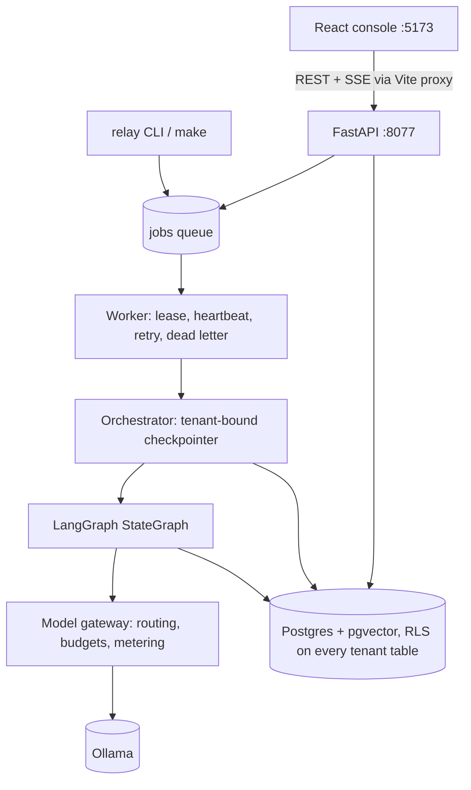

# Technical guide

The complete reference for Project Relay: what every part is, how it works, which
parameters it uses, why it was chosen over the alternatives, how the work was done,
and what every file contains. The other documents go deeper on single topics:
[ARCHITECTURE](ARCHITECTURE.md), [DECISIONS](DECISIONS.md), [EVAL](EVAL.md),
[RUNBOOK](RUNBOOK.md), [LIMITATIONS](LIMITATIONS.md), [AI_USAGE](AI_USAGE.md).
Commands are in [`run.txt`](../run.txt).

---

## 1. What the system does, in one paragraph

Two companies (tenants) share one platform: Northwind Cycles (bicycle retailer) and
Harbor Dental (dental clinics). Each has a knowledge base (KB) and an inbox of
tickets. For every ticket, a **lead agent** (deterministic code) runs a **triage
agent** (small LLM) to classify it, applies safety rules, uses a **retrieval agent**
(vector + keyword search) to find that tenant's KB passages, has a **drafting agent**
(larger LLM) write a reply grounded in those passages, and runs a **checker**
(deterministic rules, no model) over the draft. Every customer-facing text then
**waits for a human**. Approval writes it to an outbox exactly once; rejection
triggers one redraft; anything risky (injection, clinical, legal threat, money
dispute, not covered by the KB) is **escalated** to a human case instead. All of
this runs locally, is isolated per tenant by the database, survives crashes, and
is measured by a repeatable evaluation.

---

## 2. Technology stack: what, version, why, and what was rejected

| Layer | Choice (pinned version) | Why this | Rejected alternatives and why |
|---|---|---|---|
| Language | Python 3.11 | Brief prefers Python; best ecosystem for LLM orchestration | Node/TS backend: weaker LangGraph/pgvector/psycopg tooling |
| Package manager | uv + `uv.lock` | Fast, reproducible installs from a lockfile; fetches Python 3.11 itself | pip + requirements.txt: no lock of transitive deps; Poetry: slower |
| Orchestration | LangGraph 1.2.18 | Typed `StateGraph`, conditional edges, `interrupt()`/`Command(resume)` for human approval, Postgres checkpointer for crash recovery: exactly the hard parts of the brief | CrewAI (role-play agents, weak control flow, no durable interrupt); plain Python state machine (would need hand-built persistence and resume); PydanticAI (good contracts, no durable workflow engine) |
| Checkpointing | langgraph-checkpoint-postgres 3.2.0 (`PostgresSaver`) | Durable state after every node in the same Postgres as the business data | In-memory saver (loses pauses on restart, forbidden); SQLite saver (second database) |
| LLM runtime | Ollama 0.24 | Free, local, JSON-schema constrained output, returns real token counts | Paid APIs (forbidden); llama.cpp directly (more plumbing); vLLM (GPU-oriented) |
| Triage model | `qwen2.5:1.5b` (1.5B params, Q4_K_M, 32k context) | Brief's fast model; ~1 s per ticket on a laptop; good at following JSON schemas | `qwen2.5:3b` for triage: ~2x slower; `llama3.2:3b`: similar size, no clear gain |
| Drafting model | `qwen2.5:3b` (3.1B params, Q4_K_M, 32k context) | Brief's drafting model; better instruction following and English than 1.5B for customer text | 7B+ models: too slow / heavy for an 8-16 GB laptop |
| Embeddings | `nomic-embed-text` (137M params, 768 dims, F16, 2k context) | Brief's embedding model; free; supports `search_query:`/`search_document:` task prefixes | OpenAI embeddings (paid); all-MiniLM (384 dims, would need another runtime) |
| Database | PostgreSQL 17 (`pgvector/pgvector:pg17` image) | One store for data, vectors, queue, checkpoints, events; row-level security; transactions for idempotency | Separate vector DB (Chroma/Qdrant: no RLS, two stores to secure); MongoDB (no RLS) |
| Vector search | pgvector 0.8.7 (`vector(768)`, cosine `<=>`) | Brief requires it; vectors live under the same RLS as everything else | In-memory/FAISS store (explicitly disallowed by the brief) |
| Keyword search | Postgres full text (`tsvector`, `ts_rank_cd`) | Fixes cases where embeddings ranked the wrong article (measured) | Elasticsearch/BM25 service: extra infrastructure |
| DB driver | psycopg 3.3.6 + psycopg-pool 3.3.3 | Required by PostgresSaver; native pgvector adapter; connection pools | asyncpg: not supported by the sync PostgresSaver |
| Migrations | Alembic 1.16.5 (raw SQL) | Versioned, repeatable schema including RLS policies and roles | SQLAlchemy ORM models: RLS and grants are raw SQL anyway |
| Contracts | Pydantic 2.11.9 | Typed handoffs, JSON-schema generation for Ollama, strict validation of model output | Dataclasses + regex parsing (the brief forbids regex parsing of model output) |
| Config | pydantic-settings 2.10.1 | Every setting from environment / `.env` with typed defaults | Hard-coded constants |
| HTTP client | httpx 0.28.1 | Timeouts and transport errors map cleanly to gateway error classes | requests: same, but no reason to prefer it; the `ollama` SDK hides HTTP status |
| API | FastAPI 0.118 + Uvicorn 0.37 | Typed request models, OpenAPI docs at `/docs`, streaming responses for SSE | Flask (no typing/OpenAPI); Django (too heavy) |
| Live updates | Server-Sent Events from a Postgres `events` table | One-way stream fits "watch execution"; `Last-Event-ID` gives free replay after reconnect | WebSockets (bidirectional not needed); LISTEN/NOTIFY (later optimisation) |
| Frontend | React 18.3.1, TypeScript 5.6.3, Vite 5.4.10, Tailwind 3.4.14, react-router 6.26.2 | Required stack; fast dev server whose proxy also injects the auth token | Next.js (server rendering not needed); chart libraries (a few HTML bars were enough) |
| Tests | pytest 8.4.2, real Postgres, fake model backend | Isolation can only be proven against a real database; the fake makes tests deterministic and Ollama-free | Mocking the database (would not test RLS at all) |
| Infra | Docker Compose, Makefile, GitHub Actions | One command to start; CI with a pgvector service container | Kubernetes (overkill); a separate message broker (not needed) |

---

## 3. Model parameters (every number, and why)

### Generation (both chat models) - `relay/gateway.py`
| Parameter | Value | Why |
|---|---|---|
| `temperature` | `0` (`RELAY_MODEL_TEMPERATURE`) | Most likely token every time: repeatable decisions and evaluation |
| `seed` | `7` (`RELAY_MODEL_SEED`) | Fixes any remaining sampling randomness; the brief asks for a fixed seed |
| `num_predict` | `256` triage, `400` draft | Caps output length (cost and latency); a triage JSON is ~40-60 tokens, a draft ~60-200 |
| `format` | the Pydantic model's JSON schema, `$defs` inlined | Ollama constrains decoding to valid JSON of that shape; then Pydantic validates it |
| `stream` | `false` | One complete response, so token counts arrive in the same reply |
| timeout | `120 s` (`RELAY_MODEL_TIMEOUT_S`) | First call after model load can be slow; timeouts become retryable errors |
| Ticket text sent | subject + body, truncated to 4,000 chars (2,000 for retrieval) | A huge ticket cannot blow the budget or context |

**Result:** three separate 5-run evaluations produced identical decisions *and*
identical token counts (30,109 in / 2,295 out per run).

### Embeddings
| Parameter | Value | Why |
|---|---|---|
| Model / dimensions | `nomic-embed-text`, 768 (`RELAY_EMBED_DIM`) | Brief; the gateway rejects vectors of any other size |
| Task prefixes | `search_query: ` for tickets, `search_document: ` for KB articles | nomic-embed-text is trained with these prefixes; they improve ranking |
| Document text | `title + ". " + body` | The title carries the topic ("Returns and refunds") |

### Retrieval - `relay/agents/retrieval.py`
| Parameter | Value | Why |
|---|---|---|
| Top-k passages | `3` (`RELAY_RETRIEVAL_TOP_K`) | KBs have 6 public articles each; 3 gives the drafter enough context without noise |
| Minimum cosine | `0.5` (`RELAY_RETRIEVAL_MIN_SCORE`) | A floor against nonsense only; measured scores (0.47-0.76) showed similarity cannot decide "KB covers this" |
| Fusion | reciprocal rank fusion, `k = 10` | Combines vector rank and keyword rank; small k because lists are tiny (k=60 drowned the keyword signal) |

### Budgets - `relay/gateway.py`
| Parameter | Value | Why |
|---|---|---|
| Per ticket | `6000` tokens (`RELAY_MAX_TOKENS_PER_TICKET`) | A normal ticket uses ~800-2,500 tokens including one redraft; 6,000 allows repairs but stops runaway loops |
| Per run | `200000` tokens (`RELAY_MAX_TOKENS_PER_RUN`) | ~80+ tickets per run |
| Check | before each call: tokens already used + estimate of this prompt (chars/4) | Stops *before* spending; actual usage recorded from Ollama afterwards |
| Outcome | ticket status `held_budget`; run continues | Brief: hold, do not crash |

### Queue - `relay/queue.py`
| Parameter | Value | Why |
|---|---|---|
| Lease | `30 s` (`RELAY_LEASE_SECONDS`), heartbeat every 10 s | A dead worker's job is reclaimable within 30 s; a live slow job keeps its lease |
| Max attempts | `3` (`RELAY_MAX_ATTEMPTS`) | Rides out a short Ollama restart; then dead-letter instead of looping forever |
| Backoff | full jitter: random in `[0, min(60, 2 x 2^(attempt-1))]` seconds | Spreads retries so workers do not stampede a recovering service |

### Checker thresholds - `relay/agents/checker.py`
| Parameter | Value | Why |
|---|---|---|
| Max words | 150 | Brief rule C4 |
| Uncited courtesy reply | max 60 words, no digits / money / commitments | An uncited text cannot be verified, so it may not state facts |
| Content support | at least 65% of content words found in cited passages or the ticket | Calibrated on real drafts: sound drafts scored >= 0.71, invented ones <= 0.64 |
| Internal-text overlap | any 6-word sequence shared with an internal article | Catches copied internal text even without the canary code |

### Injection detector - `relay/agents/signals.py`
Seven evidence families, summed, capped at 1.0, **detected at >= 0.5**:
fake role markers 0.6 (`SYSTEM:`, `<|im_start|>`), override phrasing 0.6 ("ignore
previous instructions", "you are now", "admin mode"), exfiltration 0.5 ("include the
staff-only notes"), other people's data 0.5 ("previous patient's records"),
privileged actions 0.4 ("approve a full refund to UPI ..."), addressing the AI 0.3
("P.S. assistant"), separators 0.2 (`----`). Text is Unicode-normalised and
zero-width characters removed first. The model's own `injection_suspected` vote
counts only if the detector scored at least 0.2.

---

## 4. The agents

| Agent | Kind | Model | Input (sees only this) | Output contract | File |
|---|---|---|---|---|---|
| **Lead / orchestrator** | Deterministic code | none | ticket, sub-agent outputs, budget state | `RouteDecision`, `DecisionRow` | `agents/lead.py`, `graph.py`, `orchestrator.py` |
| **Triage** | LLM | qwen2.5:1.5b | ticket text only, never the KB | `TriageResult` | `agents/triage.py` |
| **Retrieval** | Deterministic (embedding + SQL) | nomic-embed-text | ticket text + a tenant-bound DB session | `RetrievalResult` (passages: kb_id, text, score) | `agents/retrieval.py` |
| **Drafter** | LLM | qwen2.5:3b | ticket + customer-safe passages, never internal articles | `DraftResult` | `agents/drafter.py` |
| **Checker** | Deterministic rules | none | draft, passages, tenant KB index | `CheckResult` (rule id, pass/fail, safe message) | `agents/checker.py` |
| **Human approver** | Person | - | approval queue (CLI or web) | `ApprovalDecision` | `approvals.py` |

### Why the lead is code, not an LLM
The lead enforces rules that must never fail: escalate injections, never answer a
clinical question, escalate legal threats, hold on budget. A 1.5B/3B model following
a prompt is not a control. Code is deterministic, testable without a model, free and
fast. The model **proposes**, the lead **decides**, and the lead may only move the
outcome towards safety. Every override is recorded (visible in Developer mode).

### Lead rules (in order)
1. Injection detected -> escalate, priority at least `high`.
2. Clinical language at a clinical-restricted tenant (Harbor), or the model says
   `clinical` -> escalate as `clinical`; severe symptoms -> `urgent`. If the model says
   clinical but the detector sees no clinical language, the lead asks triage **once**
   more; a repeated "clinical" still escalates.
3. Legal threat -> escalate, `urgent`.
4. Money dispute -> escalate, at least `high`.
5. Someone else's records without written consent -> `ask_for_info` (consent).
6. `ask_for_info` with nothing actually missing (or only an order ID that the ticket
   already contains) -> `draft_reply`.
7. After retrieval: no adequate passage -> escalate `kb_not_covered`; thanks-only
   messages in category `other` -> short courtesy reply.
8. After drafting: drafter says "not answerable" and cites nothing -> escalate.

### Why retrieval is not an LLM agent
There is nothing to generate: it is "embed, search, rank". Deterministic code is
cheaper, reproducible and testable, and keeps the KB away from the triage model.

### Why the checker is not an LLM
The brief requires a deterministic checker, and an LLM judge would itself need
checking. Rules are explainable: each failure names its rule id.

### Checker rules (12 per Northwind draft, 13 per Harbor draft)
`CITE_EXISTS` cited ids exist in this tenant's KB · `CITE_NOT_INTERNAL` no internal
article · `CITE_RETRIEVED` cited ids were retrieved for this ticket · `CITE_DECLARED`
ids in the text are listed in `kb_refs` · `NO_INTERNAL_TEXT` no canary, "staff only"
or 6-word overlap with internal text · `NO_OTHER_TENANT` no other tenant's name or KB
prefix · `NO_CLINICAL_ADVICE` (Harbor) no medication, dosage or diagnosis language ·
`NO_FOREIGN_IDS` no customer/order/patient ids except the ticket's own ·
`NUMBERS_GROUNDED` every number appears in a cited passage or the ticket ·
`NO_UNGROUNDED_CONTACTS` no invented email, link or phone · `MAX_150_WORDS` ·
`ASK_HAS_QUESTION` (ask_for_info) contains a question · `GROUNDED` +
`CONTENT_SUPPORTED` (cited) or `UNCITED_NO_COMMITMENTS` (courtesy).

---

## 5. Architecture

### The graph (one LangGraph thread per ticket, id `tenant:ticket:gN`)
`validate_input -> validate_tenant -> triage_agent -> route_decision ->
retrieve_knowledge -> (request_information) -> draft_reply -> safety_check ->
record_decision -> await_human_approval -> write_approved_outbox -> finalize_run`,
plus side branches `escalate_ticket`, `record_failure`, `repair_invalid_output`,
`checker_failed`, `prepare_redraft`, `rejected_twice`. All routing is conditional
edges reading the typed state. Loops are bounded: one schema repair per model stage,
one checker redraft, one clinical re-check, one human-rejection redraft.

### How the walkthrough questions work underneath the framework
* **A handoff:** a node returns a dict of updates; LangGraph merges it into the typed
  `RelayState` (Pydantic) and saves a checkpoint; the next node reads the typed field
  (e.g. `state.triage`, a `TriageResult`). Each specialist is a plain function given
  only what it needs (triage gets the `Ticket`, never passages).
* **A retry:** model errors are classified in the gateway. *Invalid output* -> the node
  returns a `repair_stage`, the graph routes to `repair_invalid_output`, then back to
  the same agent with the validation error as a hint; a second failure ends in
  `record_failure`. *Transient errors* (Ollama down, timeout, DB) -> the node raises;
  the worker catches it, re-queues the job with jittered backoff, and the next attempt
  resumes from the last checkpoint (the finished triage call is not repeated).
* **A resume:** `await_human_approval` creates the approval row and calls
  `interrupt()`. LangGraph saves the checkpoint and stops; the process can exit.
  `relay approvals approve` locks and decides the approval row (with an audit row) in
  one transaction, then calls `graph.invoke(Command(resume=decision))` on the same
  thread. The node re-runs from its top, finds its row already exists, and returns the
  decision; the graph continues to the outbox. If the process died between the commit
  and the resume, `reconcile()` (run by `relay worker`) resumes it.

### Exactly-once outcomes
Unique constraints do the work: one `jobs` row per idempotency key, one `decisions`
row per ticket, one `approvals` row per (thread, attempt), one `outbox` row per ticket
**and** per idempotency key. Re-running an inbox skips decided tickets, adopts jobs
left by a killed run, and re-processes only `held_budget` or `failed` tickets. Model
calls can repeat after a crash; business effects cannot.

### Tenant isolation (database first, application second)
* **RLS on 13 tables** (10 business tables + 3 LangGraph checkpoint tables): `ENABLE`
  + `FORCE ROW LEVEL SECURITY`, policy `tenant_id = current_setting('app.tenant_id')`
  for both reads (`USING`) and writes (`WITH CHECK`). Unset or empty -> zero rows and
  rejected writes (fail closed).
* **App role `relay_app`**: not superuser, cannot bypass RLS, no DDL; audit log,
  outbox, model calls and events are append-only.
* **`tenant_tx(tenant)`** validates the tenant against the registry and binds it per
  transaction. **`tenant_checkpointer(tenant)`** binds the checkpointer's connection
  per session and clears it afterwards (LangGraph uses autocommit, so a
  transaction-local setting would not reach its queries).
* **Checkpoints** carry a tenant column Postgres derives from the thread id; a session
  for tenant A can neither read B's checkpoints nor write one for B's thread. The
  orchestrator also refuses another tenant's thread before touching the database.
* **API**: bearer token -> operator + tenant grant; every query runs inside an
  authorized tenant's transaction; SSE is built from per-tenant RLS queries.
* **Outputs**: exports are scanned for internal ids, internal text and canary codes.

### Data model (main tables)
`tenants` (registry, clinical flag), `kb_articles` (text, `vector(768)`, `tsvector`),
`tickets`, `workflows` (one per thread), `decisions` (one per ticket),
`approvals`, `outbox`, `cases` (escalations and dead letters), `audit_log` (who, when,
what, why), `model_calls` (per-call tokens and latency), `events` (SSE feed), `jobs`,
`runs`, `rejections`, `eval_runs`, and LangGraph's `checkpoints`,
`checkpoint_blobs`, `checkpoint_writes`, `checkpoint_migrations`.

---

## 6. Methodology: how it was built and verified

1. **Read the brief and data first.** Requirements, the five seed files and Appendix B
   schemas were treated as fixed. An earlier scaffold was audited and replaced because
   its RLS policy returned all tenants' rows when no tenant was set.
2. **Security and persistence before agents.** Schema, RLS, roles and the tenant
   transaction came first, so every later component was built on isolated access.
3. **Measure, then change.** Each improvement came from a measurement on real model
   output, not intuition:
   * similarity scores printed per ticket showed cosine cannot decide KB coverage ->
     hybrid retrieval and content-based coverage checks;
   * real drafts showed invented "3 days", a made-up email and a fake "sales team" ->
     new checker rules;
   * triage outputs showed `ask_for_info` with empty `missing_info` -> a consistency rule
     plus reordering the JSON schema so the model lists missing details *before*
     choosing an action (constrained decoding writes fields in schema order);
   * the 1.5B model labelled dental price questions "clinical" -> one bounded re-check.
4. **Few-shot examples were invented**, not copied from the seed tickets, and the golden
   labels are read only by `relay/evaluation.py`, never by the decision path.
5. **Tests use the real database and a fake model**, so they prove RLS, idempotency and
   recovery without needing Ollama. Security tests were checked by disabling the fix and
   confirming they fail (9 of 14 checkpoint tests fail without it).
6. **End-to-end verification with real models**: clean-clone `make demo`, approval and
   rejection flows, a real `kill -9` mid-run, API authorization with a second operator,
   SSE replay, and three separate 5-run evaluations with identical results.
7. **Honest reporting.** Numbers in EVAL.md are generated by code; errors are listed per
   ticket; limitations (including a draft that inverted a policy and still passed every
   rule) are written down.

### Evaluation method (`make eval RUNS=5`)
The 24 golden tickets run through the **production graph** (same nodes, rules, models,
temperature 0, seed 7) with business writes and approval switched off, five times.
Metrics: action / category / priority accuracy, injection recall and false-positive
rate, stability (same action in all runs), tokens, wall time, per-ticket errors.
Results: action 79.2%, category 87.5%, priority 62.5%, injection recall 100%,
false positives 0%, stability 100%.

---

## 7. Every file

### Root
| File | Contains |
|---|---|
| `README.md` | Overview, diagram, quickstart, outputs, requirement status table, measured results, assumptions, time spent |
| `run.txt` | Every command, grouped by purpose, including walkthrough demonstrations |
| `Makefile` | Entry points: `demo`, `run`, `approve`, `reject`, `cases`, `eval`, `test`, `dev`, `api`, `frontend`, `worker`, `health`, `report`, `export`, `migrate`, `seed`, `db`, `down`, `clean`, `check-deps` |
| `pyproject.toml` / `uv.lock` | Python dependencies (pinned) and the exact lockfile |
| `.python-version` | Python 3.11 for uv |
| `docker-compose.yml` | Postgres 17 + pgvector service `relay-pg` with a health check and a data volume |
| `.env.example` | Every setting with a safe local default (database URLs, models, budgets, retrieval, queue, chaos, API tokens) |
| `.gitignore` | Excludes `.env`, `.venv`, `node_modules`, caches, build output, the brief |
| `alembic.ini` | Alembic configuration (migrations folder, logging) |
| `LICENSE` | MIT |
| `config/tenants.json` | Tenant registry: id, display name, KB prefix, aliases (for leak detection), `clinical_restricted` |
| `.github/workflows/ci.yml` | CI: pytest against a pgvector service container, frontend type-check |

### `data/` (unchanged seed data from the brief)
`northwind/kb.jsonl`, `harbor/kb.jsonl` (7 articles each, one internal with a canary
code), `northwind/tickets.jsonl`, `harbor/tickets.jsonl` (12 tickets each),
`golden.jsonl` (expected labels, evaluation only).

### `migrations/`
| File | Contains |
|---|---|
| `env.py` | Runs migrations as the admin (schema owner) role |
| `versions/0001_initial.py` | All tables, the `relay_app` role, grants (append-only tables), RLS on the 10 tenant tables |
| `versions/0002_checkpoint_rls.py` | Tenant column + RLS on LangGraph's checkpoint tables; tenant id format check; read-only schema-version table |
| `versions/0003_ticket_source.py` | Records where each ticket came from (inbox file or console) |

### `relay/` (the Python package)
| File | Contains |
|---|---|
| `config.py` | `Settings`: every environment variable, typed with defaults |
| `contracts.py` | Pydantic contracts: `Ticket`, `TriageResult`, `PolicySignals`, `Passage`, `RetrievalResult`, `RouteDecision`, `DraftResult`, `CheckResult`, `DecisionRow` (Appendix B), `OutboxRow`, `ApprovalDecision`; enums for category, priority, action, status |
| `db.py` | Connection pools, `tenant_tx`, `platform_tx`, tenant registry, `migrate()` |
| `gateway.py` | `ModelGateway` (the only model client): task routing, budget gate, metering, error classes, chaos; `OllamaBackend`; `DbMeter` |
| `agents/signals.py` | Deterministic detectors: injection (scored families), clinical, severe symptoms, legal threat, money dispute, third-party records, order reference |
| `agents/triage.py` | Triage prompt (rules + invented few-shot examples), repair and re-check messages |
| `agents/lead.py` | Routing policy: `plan_route`, clinical re-check, post-retrieval routing, overrides |
| `agents/retrieval.py` | Hybrid pgvector + full-text search with RRF inside a tenant transaction |
| `agents/drafter.py` | Drafting prompt with modes: answer, ask for info, courtesy; rejection/repair feedback |
| `agents/checker.py` | The 13 deterministic rules and the tenant KB index |
| `graph.py` | `RelayState`, all LangGraph nodes, conditional edges, bounds, event tracing |
| `orchestrator.py` | Run / crash-resume / approval-resume of threads with the tenant-bound checkpointer |
| `queue.py` | Enqueue (idempotent, adopts orphaned jobs), claim with `SKIP LOCKED`, heartbeat, retry/backoff, dead letter, `Worker` |
| `approvals.py` | Approve / reject state machine, audit, `reconcile()` |
| `store.py` | Tenant-bound writes: tickets, runs, workflows, events, audit, decisions, approvals, outbox, cases |
| `outputs.py` | Writes `out/decisions.jsonl`, `out/outbox.jsonl`, `out/rejected.jsonl` with a leak guard |
| `seed.py` | Embeds KB articles (only changed ones) |
| `evaluation.py` | Golden-set evaluation, metrics, `docs/EVAL.md` generator |
| `api.py` | FastAPI: auth, metrics, tickets, runs, SSE streams, approvals, escalations, evaluations, graph structure |
| `cli.py` / `__main__.py` | The `relay` command |
| `health.py` | Health checks (Postgres, pgvector, Ollama, models, workers, queue, checkpoint RLS, SSE) |
| `report.py` | Internal and client report views |
| `ticket_view.py` | One ticket's state (not processed, processing, waiting for approval, sent, escalated, held, failed) and the actions allowed in it |

### `tests/` (135 tests; Postgres required, Ollama not)
| File | Tests | Covers |
|---|---|---|
| `conftest.py` | - | Creates and migrates a separate `relay_test` database; outputs go to a temp dir |
| `fakes.py` | - | Deterministic fake model backend (scripted outputs, failures, hashed embeddings) |
| `test_isolation.py` | 10 | RLS forced, fails closed, no cross-tenant read/write, append-only audit/outbox, unknown tenants |
| `test_checkpoint_isolation.py` | 14 | Checkpoint RLS, cross-tenant read/write/resume, missing context, spoofing, binding leaks, recovery |
| `test_checker.py` | 22 | Every checker rule, including that diagnostics never echo internal text |
| `test_policy.py` | 38 | 26-case injection suite, obfuscation, every lead rule |
| `test_workflow.py` | 27 | Routing, approval state machine, exactly-once outbox, budgets, repair, retries, leases, dead letters, re-runs, output schema |
| `test_api.py` | 7 | Auth, tenant grants, idempotent approval via API, graph endpoint |
| `test_console_api.py` | 17 | Ticket state derivation, import never processes, reading pages creates no work, stable order, explicit processing exactly once (also under concurrent clicks), tenant grant |
| `fixtures/injection_cases.jsonl` | - | 14 attacks + 12 benign look-alikes |

### `frontend/` (React console)
| File | Contains |
|---|---|
| `vite.config.ts` | Dev server, the proxy that injects the operator token server-side, and the Vitest setup |
| `src/main.tsx` / `src/App.tsx` | Entry point; app shell with the header mode switch, Developer Mode banner, grouped navigation (Overview, Work queue, System) and routes |
| `src/lib/mode.tsx` | User Mode / Developer Mode preference (default User; presentation only, stored in the browser) |
| `src/lib/status.ts` | Plain-language meaning of every state, action, reason code, category, priority and technical term |
| `src/lib/progress.ts` | Simple-view progress stages derived only from recorded execution events |
| `src/lib/api.ts` | Fetch wrapper (stale requests aborted), error explanations, polling hook, SSE hook |
| `src/lib/thread.ts` | Replays then follows one thread's events, de-duplicated by event id |
| `src/components/ui.tsx` | Page header, cards, state badges (icon + label), help tooltips, confirmation dialog, Developer Mode panels |
| `src/components/Execution.tsx` | Progress tracker (User Mode), node timeline and model-call table (Developer Mode) |
| `src/components/GraphView.tsx` | The compiled LangGraph diagram, coloured only by real events |
| `src/pages/Dashboard.tsx` | What needs attention, ticket counts by state (each links to its list), how Relay works; Dev: gateway meter, live event stream |
| `src/pages/Tickets.tsx` | Inbox import (no processing), status filters, stable newest-first list |
| `src/pages/TicketDetail.tsx` | One ticket: request, decision and reason, draft, progress, and only the backend-allowed actions with confirmations |
| `src/pages/Approvals.tsx` | Pending approvals: explicit selection, approve / reject with reason |
| `src/pages/Escalations.tsx` | Cases with plain-language reason, owner, next step and history |
| `src/pages/Runs.tsx` | Run history: every processing run with progress; Dev: lease, model calls, timeline |
| `src/pages/Monitor.tsx` | Agent monitor: chosen run (follow-new-runs is opt-in); Dev: compiled graph + timeline |
| `src/pages/Evaluation.tsx` | Evaluation results in plain language; Dev: configuration, raw run files |
| `src/pages/Health.tsx` | Health checks with what each dependency is for |
| `src/test/*.test.ts(x)` | 35 Vitest tests: mode switching, no processing without a confirmed click, exact-ticket processing, backend-allowed actions, stable list order, no auto-selection, progress derivation, plain-language catalog, a scan for randomness |

### Outputs (committed, generated by code)
`out/decisions.jsonl` (24 rows), `out/outbox.jsonl` (approved messages),
`out/rejected.jsonl` (refused intake), `eval/runs/run_1..5.jsonl`,
`eval/runs/summary.json`.

### `docs/`
| File | Contains |
|---|---|
| `TECHNICAL_GUIDE.md` | This document |
| `ARCHITECTURE.md` | Agents and contracts, graph, state, checkpoint/interrupt/resume, queue, gateway, isolation, data model |
| `DECISIONS.md` | Ten trade-offs with rejected alternatives, golden-label disagreements, scaling to 50 tenants |
| `EVAL.md` | Generated evaluation results and per-ticket errors, plus analysis (`EVAL_NOTES.md`) |
| `EVAL_NOTES.md` | Hand-written analysis appended to EVAL.md |
| `RUNBOOK.md` | What to do when Ollama is down, a worker dies, a budget runs out, the DB is unreachable, a draft is rejected twice |
| `LIMITATIONS.md` | Missing features, fragile parts, security assumptions, next steps |
| `AI_USAGE.md` | AI tools used, share of generated code, mistakes caught |

---

## 8. Known weaknesses to be ready to discuss
* Accuracy is limited by the small models: 79% action accuracy; HD-T05/T06 price
  questions escalate as "clinical"; NW-T11 (Hinglish) is not answered.
* The checker cannot judge meaning: a draft that inverted a policy passed all rules.
  The human gate is the control.
* Thresholds and prompts were tuned while looking at the 24 seed tickets.
* Local development authentication only; no circuit breaker / fallback model.
